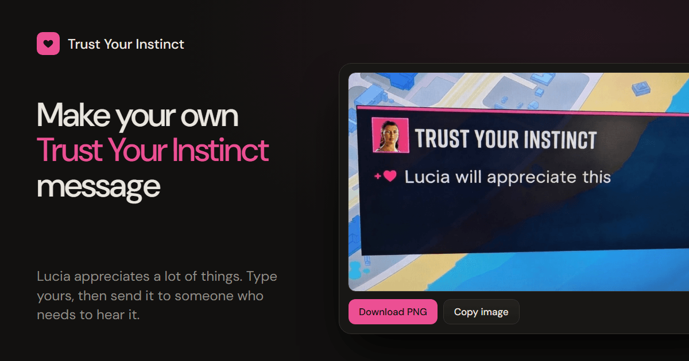

# Trust Your Instinct Generator

Make your own GTA VI “Trust Your Instinct” notification. Type a message, see it on the screenshot,
download the PNG or copy it to your clipboard.

**Live:** [instinct.szymonbludnik.dev](https://instinct.szymonbludnik.dev)



## Features

- Live preview drawn on a `<canvas>`, using the same font, tilt and slight blur as the original photo of the screen
- Panel grows smoothly when the text needs more lines (up to 3 lines / 100 characters)
- Presets for a quick start
- Download as PNG or copy the image straight to the clipboard
- Everything runs in the browser: the text never leaves your device

## Tech stack

- [Astro](https://astro.build) with React islands
- [Tailwind CSS v4](https://tailwindcss.com) and [shadcn/ui](https://ui.shadcn.com)
- [Framer Motion](https://motion.dev) for animations
- [Turborepo](https://turbo.build) + [pnpm](https://pnpm.io) workspaces
- [Alchemy](https://alchemy.run) for deploying to Cloudflare
- [Oxlint](https://oxc.rs) / Oxfmt and Husky for linting and formatting

## Getting started

Requirements: Node.js (current LTS) and pnpm.

```bash
pnpm install
pnpm dev:web
```

Open [http://localhost:4321](http://localhost:4321).

## Scripts

| Command            | Description                                |
| ------------------ | ------------------------------------------ |
| `pnpm dev:web`     | Start the Astro dev server                 |
| `pnpm dev`         | Start the app through Alchemy (Cloudflare) |
| `pnpm check-types` | Type-check all packages                    |
| `pnpm check`       | Lint with Oxlint and format with Oxfmt     |
| `pnpm deploy`      | Deploy to Cloudflare                       |
| `pnpm destroy`     | Remove the Cloudflare deployment           |

## Project structure

```
apps/web
├── public/                 base screenshot, OG image, favicon
└── src/
    ├── components/
    │   ├── generator/      editor, presets, export buttons, preview
    │   └── ui/             shadcn/ui components
    ├── hooks/              canvas rendering and element size hooks
    ├── layouts/            HTML shell, meta tags, analytics
    ├── lib/                text rendering, smooth scroll, motion presets
    ├── pages/              index page
    └── styles/             theme and global styles
packages/
├── config/                 shared TypeScript config
└── infra/                  Alchemy stack for Cloudflare
```

## How the image is made

`apps/web/src/lib/render-message.ts` takes the base screenshot (`public/base.webp`, 2000×1143)
and draws the text over it:

1. The font size is calibrated so a reference line matches its width in the original photo.
2. Text is wrapped to the panel width, and very long words are split.
3. For each extra line, a thin strip of the panel is stretched so the panel grows.
4. Each line is slightly rotated to follow the perspective of the photographed TV, then softened
   with a small blur and shadow.

## Deployment

The site is deployed to Cloudflare with Alchemy. Set `ALCHEMY_PASSWORD` in `packages/infra/.env`,
then run:

```bash
pnpm deploy
```

## Privacy

The image is generated in the browser and the message is never sent anywhere. The site uses a
simple analytics script to count visits.

## License

The code is released under the [MIT License](LICENSE). The base screenshot (`apps/web/public/base.webp`)
is not covered by it, see the disclaimer below.

## Disclaimer

Fan-made project, not affiliated with or endorsed by Rockstar Games or Take-Two Interactive.
Grand Theft Auto and all related assets belong to their respective owners.

---

Made with ♥ by [Simciutoja](https://szymonbludnik.dev/) 🇵🇱
